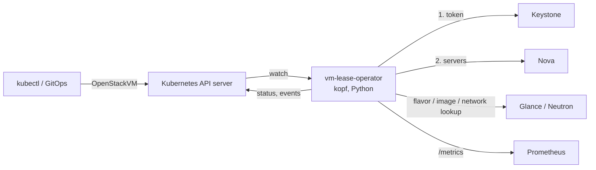

# vm-lease-operator

[](https://github.com/Satya-0023/vm-lease-operator/actions/workflows/ci.yml)

A Kubernetes operator that manages **OpenStack virtual machines with an expiry lease**.

You describe a VM as a Kubernetes object, with how long you need it:

```yaml
apiVersion: vmlease.io/v1alpha1
kind: OpenStackVM
metadata:
  name: dev-box
spec:
  flavor: m1.small
  image: cirros
  network: private
  ttl: 2h            # lease length
  onExpiry: Delete   # or Stop
```

The operator creates the VM in OpenStack (Nova), keeps it in the state you asked for, and
reclaims it when the lease runs out.

```
$ kubectl get osvm
NAME      PHASE    IP          EXPIRES                AGE
dev-box   Active   10.0.0.10   2026-11-12T17:26:50Z   21s
```

## Why

In a private cloud, dev and test VMs get created for a quick experiment and then forgotten.
They hold CPU, RAM and IPs nobody is using. Leases fix that: every VM has an owner and an end
date.

This project does it the Kubernetes way, so teams that already deploy apps with `kubectl`,
Helm or GitOps can request VMs the same way, with the same RBAC, audit trail and tooling.

## What it does

| Situation | What the operator does |
|---|---|
| New `OpenStackVM` object | Resolves flavor, image, network names to IDs, creates the Nova server, tags it with the object's UID |
| VM is booting | Reports `Building`, then `Active` with its IP |
| Someone deletes the VM in Horizon or the CLI | Notices on the next check (default 10 s) and recreates it (`ServerMissing` event) |
| Operator crashed after creating a VM but before saving its ID | Finds the VM by its UID tag and adopts it, so no duplicate VM |
| Nova puts the VM in `ERROR` | Reports `Error` with Nova's fault message; does not loop recreating |
| `spec.ttl` raised | Lease extended; `expiresAt` moves |
| Lease ends | Deletes (or stops) the VM; object stays as `Expired`, a record of what existed |
| `kubectl delete` | A finalizer holds the object until the VM is deleted in OpenStack, so nothing is orphaned |
| Bad input (`ttl: forever`, changing flavor later) | Rejected by the API server before the operator sees it (CRD schema + CEL rule) |
| OpenStack unreachable or 5xx | Keeps the last known state, writes `retrying: ...` to status, tries again next tick |

Every step emits a Kubernetes event (`kubectl describe osvm dev-box`) and a Prometheus metric.

## Architecture



The operator is about 430 lines of Python, plus a 260-line fake cloud and 32 tests:

| File | Role |
|---|---|
| `vmlease/reconciler.py` | The brain. Desired state + recorded state + what Nova says → new state + events. No Kubernetes code, fully unit tested |
| `vmlease/openstack_client.py` | Hand-written REST client: Keystone v3 login, service catalog, token refresh, Nova/Glance/Neutron calls |
| `vmlease/main.py` | kopf wiring: one timer (reconcile loop) and one delete handler (cleanup + finalizer) |
| `vmlease/lease.py` | Duration parsing and expiry maths |
| `vmlease/metrics.py` | Prometheus counters, gauge, latency histogram |
| `fakestack/app.py` | In-memory fake of the Keystone, Nova, Glance and Neutron APIs (Flask) for demos and tests |
| `deploy/` | CRD, RBAC, Deployment, fakestack, example |
| `scripts/e2e.sh` | Builds everything, runs it on kind, walks a VM through its whole life |

## Run it

Needs Docker, [kind](https://kind.sigs.k8s.io/) and kubectl (Linux or WSL2).

```bash
bash scripts/e2e.sh
```

That creates a kind cluster, builds and loads both images, deploys, and then checks:
create, schema validation, self-healing after an out-of-band delete, lease expiry, delete with
finalizer, and metrics. It ends with `E2E PASSED`. Re-running reuses the cluster.

Try it by hand afterwards:

```bash
kubectl apply -f deploy/examples/dev-vm.yaml
kubectl get osvm -w
kubectl describe osvm dev-box
kubectl patch osvm dev-box --type merge -p '{"spec":{"ttl":"4h"}}'   # extend the lease
kubectl delete osvm dev-box
```

### Unit tests

```bash
python -m venv .venv && . .venv/bin/activate
pip install -r requirements.txt -r requirements-dev.txt
pytest -q          # 32 tests, ~10 s, runs fakestack in-process; no cluster needed
```

### Run the operator on your machine (no image build)

```bash
python -m fakestack.app &                       # fake cloud on :5000
kubectl apply -f deploy/crd.yaml                # any cluster in your kubeconfig
export OS_AUTH_URL=http://127.0.0.1:5000/identity/v3 OS_USERNAME=demo OS_PASSWORD=secret OS_PROJECT_NAME=demo
PYTHONPATH=. kopf run --standalone --all-namespaces -m vmlease.main
```

If the in-cluster operator is also running, scale it to 0 first
(`kubectl -n vmlease-system scale deploy/vmlease-operator --replicas=0`): two copies would both
act on every VM.

### Using a real OpenStack

The operator reads the standard `OS_*` variables from an openrc file. Create the secret from
yours and skip `deploy/fakestack.yaml`:

```bash
kubectl apply -f deploy/crd.yaml -f deploy/operator.yaml
kubectl -n vmlease-system create secret generic openstack-credentials \
  --from-literal=OS_AUTH_URL=$OS_AUTH_URL --from-literal=OS_USERNAME=$OS_USERNAME \
  --from-literal=OS_PASSWORD=$OS_PASSWORD --from-literal=OS_PROJECT_NAME=$OS_PROJECT_NAME \
  --from-literal=OS_USER_DOMAIN_NAME=Default --from-literal=OS_PROJECT_DOMAIN_NAME=Default
```

The client only uses stable public APIs (Keystone v3, Nova v2.1, Glance v2, Neutron v2.0)
with the same URL layout as DevStack. **Status: tested against fakestack only so far**, not yet
against a real DevStack or Private Cloud Director.

## Metrics

| Metric | Meaning |
|---|---|
| `vmlease_vms{phase}` | Objects per phase (Active, Expired, Error...) |
| `vmlease_events_total{reason}` | Created, Ready, ServerMissing, Adopted, LeaseExpired... |
| `vmlease_reconcile_total{result}` | ok / error |
| `vmlease_openstack_request_seconds{service,method}` | OpenStack API latency |

## Limitations (on purpose, to keep it small)

- Polls Nova every 10 s per VM. Fine for hundreds of VMs; for thousands, listen to OpenStack
  notifications (oslo.messaging) or batch one `GET /servers/detail` per tick.
- One replica, no leader election (`--standalone`). Two copies would both act on every VM.
- No resize, rebuild, volumes, floating IPs, security groups or keypairs.
- No per-namespace policy yet (for example "max ttl 8h in namespace dev").
- `find_servers` reads one page of `/servers/detail` (no pagination).
